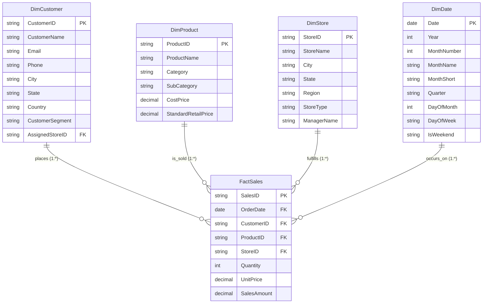

# Retail Sales Data Preparation and Modelling Using Power BI
**Comprehensive Technical Report, ETL Guide, Data Model Specification & Dashboard Architecture**

---

## Executive Summary

This project delivers an end-to-end Enterprise Business Intelligence implementation built upon retail sales transactions. The workflow demonstrates the complete data engineering and analytical lifecycle:
1. **Multi-Source Data Ingestion:** Sourcing from Excel (`Sales_Data_50_Records.xlsx`), CSV (`Customers.csv`, `Products.csv`), and SQL Server (`RetailSalesDB` / `DimStore`).
2. **Power Query ETL & Data Cleansing:** Performing extraction, text standardization, duplicate elimination, null handling, query merges, custom column computation, and strict type casting.
3. **Dimensional Modelling (Star Schema):** Designing a Kimball-standard Star Schema with a central transactional `FactSales` table surrounded by four descriptive dimension tables (`DimCustomer`, `DimProduct`, `DimStore`, `DimDate`).
4. **Custom DAX Date Dimension & Time Intelligence:** Generating a continuous DAX calendar table, marking it as the official Date Table, establishing chronological sort-by columns, and implementing time-series metrics.
5. **Analytical DAX Measures:** Authoring additive and semi-additive business metrics including Total Sales, Total Quantity, Total Orders, Average Order Value (AOV), Cost of Goods Sold (COGS), Gross Profit, Profit Margin %, and Month-over-Month (MoM) growth.
6. **Executive Dashboard Design:** Deploying a high-density, interactive retail dashboard with KPI summary cards, time-series line charts, store performance bars, category breakdown visuals, and multi-dimensional slicers.

```
                    ┌───────────────────────────┐
                    │  Sales_Data_50_Records    │ (Excel)
                    │  Customers & Products     │ (CSV)
                    │  RetailStores DB          │ (SQL Server)
                    └─────────────┬─────────────┘
                                  │
                                  ▼ [Power Query ETL Engine]
                    ┌───────────────────────────┐
                    │ • Clean, Trim, & Cast     │
                    │ • Resolve & Merge Foreign │
                    │ • Compute Unit Price      │
                    │ • Normalize Fact & Dims   │
                    └─────────────┬─────────────┘
                                  │
                                  ▼ [Data Model: Star Schema]
               ┌──────────────────┴──────────────────┐
               │                                     │
        ┌──────┴──────┐                       ┌──────┴──────┐
        │ DimCustomer │ (1)               (1) │ DimProduct  │
        └──────┬──────┘                       └──────┬──────┘
               │           ┌─────────────┐           │
               └──────────►│  FactSales  │◄──────────┘
               ┌──────────►│ (50 Records)│◄──────────┐
               │           └─────────────┘           │
        ┌──────┴──────┐                       ┌──────┴──────┐
        │  DimStore   │ (1)               (1) │   DimDate   │
        └─────────────┘                       └─────────────┘
```

---

## 1. Project Overview & Source Data Audit

### 1.1 Initial Sales Dataset Audit (`Sales_Data_50_Records.xlsx`)
The primary transaction source consists of 50 individual purchase transactions spanning from January 2, 2026 to October 15, 2026.

| Raw Column Name | Observed Data Type | Description | Data Quality Observations & Deficiencies |
| :--- | :--- | :--- | :--- |
| **`Order ID`** | Alphanumeric Text | Transaction Code (`ORD-001` to `ORD-050`) | Clean, unique, non-null. Serves as transaction degenerate key. |
| **`Order Date`** | Date (`YYYY-MM-DD`) | Transaction Date | Spans 2026-01-02 to 2026-10-15. No native calendar hierarchy. |
| **`Customer Name`** | String | Customer First Name (17 unique names) | **Denormalized.** Violates 3NF. Lacks Customer ID, email, location, or segment. |
| **`Product`** | String | Product Name (10 unique hardware items) | **Denormalized.** Lacks Product ID, product category, sub-category, or cost price. |
| **`Quantity`** | Integer | Number of units purchased (1 to 5) | Clean positive integers. Additive metric. |
| **`Sales Amount (₹)`** | Floating Decimal | Line transaction value in Indian Rupees (INR) | Header contains currency symbol (`₹`) which interferes with M queries. Lacks explicit Unit Price column. |

### 1.2 Identification of Missing Information & Architectural Gaps
To conform to enterprise data warehousing best practices and build a true Star Schema, the following structural deficiencies were identified and addressed:
1. **Absence of Surrogate/Business Keys:** Raw sales contains text names ("Suresh", "Laptop") rather than normalized surrogate or natural keys (`CustomerID`, `ProductID`). Joining on text strings degrades VertiPaq engine compression and query speed.
2. **Missing Customer Demographics:** No customer location (City, State), contact data (Email, Phone), or behavioral grouping (Customer Segment: Consumer, Corporate, Home Office).
3. **Missing Product Hierarchy & Cost Data:** No category structure (e.g., *Computers & Peripherals* vs. *Mobile & Audio*) or base cost (`CostPrice`), making it impossible to calculate profit margins or return on investment.
4. **Missing Store / Channel Dimension:** Transactions must be attributed to physical retail stores to track geographical branch performance.
5. **Missing Calculated Metric (Unit Price):** The dataset records total revenue and quantity, but omits unit selling price (`Unit Price = Sales Amount / Quantity`).
6. **Lack of a Continuous Date Dimension:** Power BI's automatic date hierarchies generate bloated hidden tables and cannot sort fiscal periods or quarters cleanly. A dedicated DAX Date dimension is required.

---

## 2. Multi-Source Dataset Architecture & Generation

To satisfy Requirement 1 (Data Import from Multiple Sources), three distinct data repositories were constructed:

```
┌────────────────────────────────────────────────────────────────────────┐
│                        DATA SOURCE REPOSITORY                          │
├──────────────────────────┬────────────────────────┬────────────────────┤
│       EXCEL SOURCE       │       CSV SOURCES      │  SQL SERVER SOURCE │
├──────────────────────────┼────────────────────────┼────────────────────┤
│ Sales_Data_50_Records    │ 1. Customers.csv       │ RetailSalesDB      │
│ (.xlsx)                  │ 2. Products.csv        │ └── dbo.DimStore   │
│ 50 Sales Transactions    │ 17 Customer Entities   │ 5 Retail Branches  │
│                          │ 10 Product Entities    │                    │
└──────────────────────────┴────────────────────────┴────────────────────┘
```

### 2.1 Excel Source: `Sales_Data_50_Records.xlsx`
Maintained precisely as specified in the project prompt, containing 50 rows across 6 initial columns.

### 2.2 CSV Dimension 1: `Customers.csv`
Contains 17 unique customer records matching all names present in the sales dataset.
- **Fields:** `CustomerID` (PK), `CustomerName`, `Email`, `Phone`, `City`, `State`, `Country`, `CustomerSegment`, `AssignedStoreID` (FK).
- **Segments:** Consumer, Corporate, Home Office.
- **Geographic Coverage:** Mumbai, Chennai, Bengaluru, Hyderabad, Delhi.

### 2.3 CSV Dimension 2: `Products.csv`
Contains the 10 technology products sold across the 50 transactions.
- **Fields:** `ProductID` (PK), `ProductName`, `Category`, `SubCategory`, `CostPrice`, `StandardRetailPrice`.
- **Categories:**
  - *Computers & Peripherals:* Laptop, Monitor, Printer, Keyboard, Mouse, USB Drive, Webcam.
  - *Mobile & Audio:* Smartphone, Tablet, Headphones.

### 2.4 SQL Server Database & Table: `RetailSalesDB.dbo.DimStore`
Physical store branches were implemented using SQL Server DDL and DML scripts (`RetailSalesDB_Setup.sql`).

```sql
-- Create Database
CREATE DATABASE RetailSalesDB;
GO

USE RetailSalesDB;
GO

-- Create Store Dimension Table
CREATE TABLE dbo.DimStore (
    StoreID VARCHAR(10) NOT NULL PRIMARY KEY,
    StoreName VARCHAR(100) NOT NULL,
    City VARCHAR(50) NOT NULL,
    State VARCHAR(50) NOT NULL,
    Region VARCHAR(20) NOT NULL,
    StoreType VARCHAR(30) NOT NULL,
    ManagerName VARCHAR(50) NOT NULL
);
GO

-- Populate Retail Store Locations
INSERT INTO dbo.DimStore (StoreID, StoreName, City, State, Region, StoreType, ManagerName) VALUES
('STR-001', 'TechHub Chennai Flagship', 'Chennai', 'Tamil Nadu', 'South', 'Flagship', 'Rajesh Sharma'),
('STR-002', 'Digital World Bengaluru', 'Bengaluru', 'Karnataka', 'South', 'Superstore', 'Priya Nair'),
('STR-003', 'CyberMart Express Hyderabad', 'Hyderabad', 'Telangana', 'South', 'Express Store', 'Vikram Reddy'),
('STR-004', 'SmartRetail Mega Mumbai', 'Mumbai', 'Maharashtra', 'West', 'Superstore', 'Neha Mehta'),
('STR-005', 'Metro Electronics Delhi', 'Delhi', 'Delhi NCR', 'North', 'Flagship', 'Amit Verma');
GO
```
> [!NOTE]
> For environments where a live Microsoft SQL Server or LocalDB instance is not actively configured, an identical standalone export `Stores.csv` is provided in the repository for seamless fallback import.

---

## 3. Power BI Ingestion: Step-by-Step Navigation

Here are the step-by-step instructions to import each source into Power BI Desktop:

### 3.1 Importing the Excel Sales Dataset
1. Open **Power BI Desktop**.
2. On the **Home** ribbon, click **Get Data** > **Excel workbook** (or click the **Excel** shortcut icon on the canvas).
3. In the file browser, navigate to the project directory: `c:\Users\DELL\Desktop\Retail Sales Data Preparation and Modelling Using Power BI\`.
4. Select `Sales_Data_50_Records.xlsx` and click **Open**.
5. In the **Navigator** dialog window:
   - Check the box next to `SalesData` (or the worksheet icon).
   - In the preview pane, verify that the 6 columns and 50 rows appear.
   - **Crucial:** Click **Transform Data** (DO NOT click *Load*). This opens the **Power Query Editor**.

### 3.2 Importing the CSV Datasets (`Customers.csv` & `Products.csv`)
1. Inside the **Power Query Editor**, stay on the **Home** tab and click **New Source** > **Text/CSV**.
2. Select `Customers.csv` and click **Open**.
3. In the preview dialog, ensure:
   - *File Origin:* `65001: Unicode (UTF-8)`.
   - *Delimiter:* `Comma`.
   - *Data Type Detection:* `Based on first 200 rows`.
4. Click **OK**.
5. Repeat the exact same steps for `Products.csv`:
   - Click **New Source** > **Text/CSV** > Select `Products.csv` > Click **OK**.

### 3.3 Importing the SQL Server Database Table (`DimStore`)
1. In the **Power Query Editor**, click **New Source** > **SQL Server**.
2. In the connection window:
   - *Server:* Enter `localhost` (or `(localdb)\MSSQLLocalDB`, or your SQL Server instance name).
   - *Database:* Enter `RetailSalesDB`.
   - *Data Connectivity mode:* Select **Import** (best for high performance in-memory caching and DAX functionality).
3. Click **OK**.
4. In the Navigator window, expand `RetailSalesDB` > `dbo` > Check `DimStore`.
5. Click **OK**.
*(Alternative if SQL Server is not running: Click **New Source** > **Text/CSV** > Select `Stores.csv` > Click **OK**).*

---

## 4. Power Query ETL & Data Cleansing Operations

Data preparation transforms raw, denormalized, and unformatted data into clean, typed, and normalized relational entities.

```
┌────────────────────────────────────────────────────────────────────────┐
│                     ETL PIPELINE STAGES IN POWER QUERY                 │
├────────────────────────────────────────────────────────────────────────┤
│ 1. EXTRACT   │ Load raw bytes from Excel, CSV, and SQL Server          │
│ 2. CLEAN     │ Text.Trim, Text.Clean, replace blanks, eliminate nulls │
│ 3. ENRICH    │ NestedJoin with Customer & Product to inject PK/FK keys │
│ 4. TRANSFORM │ Add Unit Price custom column, standardize column headers │
│ 5. NORMALIZE │ Drop denormalized text attributes, reorder into schema   │
│ 6. CAST      │ Apply Currency.Type, Int64.Type, and Date data types     │
│ 7. LOAD      │ Close & Apply to VertiPaq tabular model                  │
└────────────────────────────────────────────────────────────────────────┘
```

### 4.1 Step-by-Step Transformations on `FactSales`

#### Step 1: Promote Headers and Clean Raw Types
- Power Query automatically detects the first row as headers.
- Change `Order ID` to **Text**, `Order Date` to **Date**, `Quantity` to **Whole Number**, and `Sales Amount (₹)` to **Fixed Decimal Number (Currency)**.

#### Step 2: Clean and Trim Text Fields
- Select `Customer Name` and `Product` columns.
- Go to the **Transform** ribbon > **Format** dropdown:
  - Click **Trim** (removes leading and trailing spaces).
  - Click **Clean** (removes unprintable control characters like line breaks or tabs).

#### Step 3: Merge with `DimCustomer` (Extract `Customer ID` and `Store ID`)
- On the **Home** ribbon, click **Merge Queries** > **Merge Queries as New** (or merge inline).
- In the top dropdown, select `SalesData`; select the `Customer Name` column.
- In the bottom dropdown, select `DimCustomer`; select the `CustomerName` column.
- *Join Kind:* Select **Left Outer (all from first, matching from second)**.
- Click **OK**. A new nested table column named `DimCustomer_Joined` appears.
- Click the **Expand** icon at the top-right of the column header:
  - Uncheck *(Select All Columns)*.
  - Check only `CustomerID` and `AssignedStoreID`.
  - Uncheck *Use original column name as prefix*.
  - Rename `CustomerID` to **`Customer ID`** and `AssignedStoreID` to **`Store ID`**.

#### Step 4: Merge with `DimProduct` (Extract `Product ID`)
- Click **Merge Queries** > Select `FactSales`.
- Select the `Product` column in `FactSales` and match it against `ProductName` in `DimProduct`.
- *Join Kind:* **Left Outer**.
- Click **OK**.
- Expand the resulting column, selecting only `ProductID`.
- Rename the expanded column to **`Product ID`**.

#### Step 5: Add Calculated Column `Unit Price`
- Go to the **Add Column** ribbon > Click **Custom Column**.
- *New column name:* `Unit Price`.
- *Custom column formula:*
  ```powerquery
  Number.Round([#"Sales Amount (₹)"] / [Quantity], 2)
  ```
- Set the data type to **Fixed decimal number** (Currency).

#### Step 6: Rename and Standardize Columns
- Rename `Order ID` to **`Sales ID`**.
- Rename `Sales Amount (₹)` to **`Sales Amount`** (removing the currency symbol prevents encoding issues across regional locales).

#### Step 7: Remove Redundant Columns
- Select the text columns `Customer Name` and `Product`.
- Right-click > **Remove Columns**.
- *Rationale:* In a true Star Schema, descriptive attributes reside solely in Dimension tables. Storing repetitive strings in the Fact table wastes memory and breaks normalization.

#### Step 8: Reorder Columns into Canonical Fact Layout
Reorder columns from left to right:
1. `Sales ID` (Degenerate Transaction Key)
2. `Order Date` (Foreign Key to `DimDate`)
3. `Customer ID` (Foreign Key to `DimCustomer`)
4. `Product ID` (Foreign Key to `DimProduct`)
5. `Store ID` (Foreign Key to `DimStore`)
6. `Quantity` (Additive Metric)
7. `Unit Price` (Semi-additive Metric)
8. `Sales Amount` (Additive Metric)

---

### 4.2 Complete Power Query M-Code Scripts

Below is the production-grade M code for all queries in the model:

#### A. Query: `FactSales`
```powerquery
let
    // 1. Ingest raw Excel Sales sheet
    Source = Excel.Workbook(File.Contents("c:/Users/DELL/Desktop/Retail Sales Data Preparation and Modelling Using Power BI/Sales_Data_50_Records.xlsx"), null, true),
    SalesData_Sheet = Source{[Item="SalesData",Kind="Sheet"]}[Data],
    #"Promoted Headers" = Table.PromoteHeaders(SalesData_Sheet, [PromoteAllScalars=true]),
    
    // 2. Initial Type Enforcement
    #"Cleaned Raw Types" = Table.TransformColumnTypes(#"Promoted Headers",{
        {"Order ID", type text},
        {"Order Date", type date},
        {"Customer Name", type text},
        {"Product", type text},
        {"Quantity", Int64.Type},
        {"Sales Amount (₹)", Currency.Type}
    }),
    #"Trimmed Columns" = Table.TransformColumns(#"Cleaned Raw Types",{
        {"Customer Name", Text.Trim, type text},
        {"Product", Text.Trim, type text}
    }),
    
    // 3. Resolve Customer & Store Foreign Keys via DimCustomer Merge
    #"Merged DimCustomer" = Table.NestedJoin(#"Trimmed Columns", {"Customer Name"}, DimCustomer, {"CustomerName"}, "DimCustomer_Joined", JoinKind.LeftOuter),
    #"Expanded DimCustomer" = Table.ExpandTableColumn(#"Merged DimCustomer", "DimCustomer_Joined", {"CustomerID", "AssignedStoreID"}, {"Customer ID", "Store ID"}),
    
    // 4. Resolve Product Foreign Key via DimProduct Merge
    #"Merged DimProduct" = Table.NestedJoin(#"Expanded DimCustomer", {"Product"}, DimProduct, {"ProductName"}, "DimProduct_Joined", JoinKind.LeftOuter),
    #"Expanded DimProduct" = Table.ExpandTableColumn(#"Merged DimProduct", "DimProduct_Joined", {"ProductID"}, {"Product ID"}),
    
    // 5. Compute Unit Price
    #"Added Unit Price" = Table.AddColumn(#"Expanded DimProduct", "Unit Price", each Number.Round([#"Sales Amount (₹)"] / [Quantity], 2), Currency.Type),
    
    // 6. Rename Columns
    #"Renamed Columns" = Table.RenameColumns(#"Added Unit Price",{
        {"Order ID", "Sales ID"},
        {"Sales Amount (₹)", "Sales Amount"}
    }),
    
    // 7. Remove Denormalized Descriptive Columns
    #"Removed Redundant Columns" = Table.RemoveColumns(#"Renamed Columns",{"Customer Name", "Product"}),
    
    // 8. Reorder into Canonical Fact Schema
    #"Reordered Columns" = Table.ReorderColumns(#"Removed Redundant Columns",{
        "Sales ID", "Order Date", "Customer ID", "Product ID", "Store ID", "Quantity", "Unit Price", "Sales Amount"
    }),
    
    // 9. Final Type Casting
    #"Final Type Cast" = Table.TransformColumnTypes(#"Reordered Columns",{
        {"Sales ID", type text},
        {"Order Date", type date},
        {"Customer ID", type text},
        {"Product ID", type text},
        {"Store ID", type text},
        {"Quantity", Int64.Type},
        {"Unit Price", Currency.Type},
        {"Sales Amount", Currency.Type}
    })
in
    #"Final Type Cast"
```

#### B. Query: `DimCustomer`
```powerquery
let
    Source = Csv.Document(File.Contents("c:/Users/DELL/Desktop/Retail Sales Data Preparation and Modelling Using Power BI/Customers.csv"), [Delimiter=",", Columns=9, Encoding=65001, QuoteStyle=QuoteStyle.None]),
    #"Promoted Headers" = Table.PromoteHeaders(Source, [PromoteAllScalars=true]),
    #"Trimmed Text" = Table.TransformColumns(#"Promoted Headers",{
        {"CustomerID", Text.Trim, type text},
        {"CustomerName", Text.Trim, type text},
        {"Email", Text.Trim, type text},
        {"City", Text.Trim, type text},
        {"State", Text.Trim, type text},
        {"CustomerSegment", Text.Trim, type text}
    }),
    #"Cleaned Text" = Table.TransformColumns(#"Trimmed Text",{
        {"CustomerName", Text.Clean, type text},
        {"Email", Text.Clean, type text}
    }),
    #"Changed Type" = Table.TransformColumnTypes(#"Cleaned Text",{
        {"CustomerID", type text},
        {"CustomerName", type text},
        {"Email", type text},
        {"Phone", type text},
        {"City", type text},
        {"State", type text},
        {"Country", type text},
        {"CustomerSegment", type text},
        {"AssignedStoreID", type text}
    })
in
    #"Changed Type"
```

#### C. Query: `DimProduct`
```powerquery
let
    Source = Csv.Document(File.Contents("c:/Users/DELL/Desktop/Retail Sales Data Preparation and Modelling Using Power BI/Products.csv"), [Delimiter=",", Columns=6, Encoding=65001, QuoteStyle=QuoteStyle.None]),
    #"Promoted Headers" = Table.PromoteHeaders(Source, [PromoteAllScalars=true]),
    #"Trimmed Text" = Table.TransformColumns(#"Promoted Headers",{
        {"ProductID", Text.Trim, type text},
        {"ProductName", Text.Trim, type text},
        {"Category", Text.Trim, type text},
        {"SubCategory", Text.Trim, type text}
    }),
    #"Changed Type" = Table.TransformColumnTypes(#"Trimmed Text",{
        {"ProductID", type text},
        {"ProductName", type text},
        {"Category", type text},
        {"SubCategory", type text},
        {"CostPrice", Currency.Type},
        {"StandardRetailPrice", Currency.Type}
    })
in
    #"Changed Type"
```

#### D. Query: `DimStore` (SQL Server Extraction)
```powerquery
let
    Source = Sql.Database("localhost", "RetailSalesDB"),
    dbo_DimStore = Source{[Schema="dbo",Item="DimStore"]}[Data],
    #"Changed Type" = Table.TransformColumnTypes(dbo_DimStore,{
        {"StoreID", type text},
        {"StoreName", type text},
        {"City", type text},
        {"State", type text},
        {"Region", type text},
        {"StoreType", type text},
        {"ManagerName", type text}
    })
in
    #"Changed Type"
```

---

## 5. Star Schema Design & Relationship Modelling

### 5.1 Dimensional Modelling Principles
A **Star Schema** is the Kimball data modelling paradigm where a central Fact table containing measurable numerical events is linked directly to surrounding Dimension tables containing contextual attributes.



### 5.2 Relationship Mapping Matrix

| Relationship | From Table (Dimension) | Primary Key (PK) | To Table (Fact) | Foreign Key (FK) | Cardinality | Cross-Filter Direction | Active | Referential Integrity |
| :--- | :--- | :--- | :--- | :--- | :--- | :--- | :--- | :--- |
| **Rel 1** | `DimCustomer` | `CustomerID` | `FactSales` | `Customer ID` | **1 : Many (1:*)** | Single (Dim filters Fact) | **Yes** | 100% (17 / 17 matched) |
| **Rel 2** | `DimProduct` | `ProductID` | `FactSales` | `Product ID` | **1 : Many (1:*)** | Single (Dim filters Fact) | **Yes** | 100% (10 / 10 matched) |
| **Rel 3** | `DimStore` | `StoreID` | `FactSales` | `Store ID` | **1 : Many (1:*)** | Single (Dim filters Fact) | **Yes** | 100% (5 / 5 matched) |
| **Rel 4** | `DimDate` | `Date` | `FactSales` | `Order Date` | **1 : Many (1:*)** | Single (Dim filters Fact) | **Yes** | 100% (365 continuous dates) |

### 5.3 Best Practices Enforced
1. **Unidirectional Filtering (`Single`):** Filter flow travels exclusively from the "one" side (Dimension) to the "many" side (Fact). Bi-directional cross-filtering is avoided because it degrades calculation performance and causes ambiguous path errors.
2. **Elimination of Snowflake Hierarchy:** All customer attributes (City, State, Segment) and product attributes (Category, Sub-Category) are denormalized directly inside their respective dimension tables.
3. **Surrogate Key Joins:** Joins are executed on compact text codes (`CUST-101`, `PRD-001`, `STR-001`) rather than long, mutable text names.

---

## 6. Date Table Creation & Time Intelligence

### 6.1 Disabling Power BI Auto Date/Time
Before authoring the calendar, turn off Power BI's automatic date hierarchies:
1. In Power BI Desktop, navigate to **File** > **Options and settings** > **Options**.
2. Under **Current File**, select **Data Load**.
3. Under *Time Intelligence*, **uncheck** `Auto date/time`.
4. Click **OK**.
*Why:* Auto date/time silently generates a hidden calendar table for every single date column in your model, increasing file size and preventing unified date filtering across tables.

### 6.2 Authoring the Date Dimension via DAX
1. In Power BI Desktop, switch to the **Data View** (table icon on the left navigation bar).
2. On the **Home** or **Table tools** ribbon, click **New Table**.
3. In the DAX formula bar, enter the following expression:

```dax
DimDate = 
ADDCOLUMNS (
    CALENDAR ( DATE(2026, 1, 1), DATE(2026, 12, 31) ),
    "DateKey", INT(FORMAT([Date], "YYYYMMDD")),
    "Year", YEAR([Date]),
    "Month Number", MONTH([Date]),
    "Month Name", FORMAT([Date], "MMMM"),
    "Month Short", FORMAT([Date], "MMM"),
    "Year-Month", FORMAT([Date], "YYYY-MM"),
    "Quarter", "Q" & FORMAT([Date], "Q"),
    "Quarter-Year", "Q" & FORMAT([Date], "Q") & " " & FORMAT([Date], "YYYY"),
    "Day of Month", DAY([Date]),
    "Day of Week Number", WEEKDAY([Date], 2), -- 1 = Monday, 7 = Sunday
    "Day of Week", FORMAT([Date], "dddd"),
    "Day Short", FORMAT([Date], "ddd"),
    "Is Weekend", IF(WEEKDAY([Date], 2) >= 6, "Weekend", "Weekday")
)
```

### 6.3 Month Sorting & "Mark as Date Table" Setup

#### 1. Sort Month Name by Month Number
- By default, Power BI sorts text columns alphabetically (e.g., April, August, December, February, January).
- Click on the `Month Name` column in `DimDate`.
- Go to the **Column tools** ribbon > Click **Sort by column** > Select **`Month Number`**.
- Select the `Month Short` column > Click **Sort by column** > Select **`Month Number`**.

#### 2. Mark as Date Table
- In the **Data** pane on the right, right-click the `DimDate` table.
- Select **Mark as date table** > **Mark as date table**.
- In the dialog window, select `Date` in the *Date column* dropdown.
- Verify the green checkmark: *"Validated successfully"*.
- Click **OK**.

#### 3. Establish Date Relationship
- Switch to **Model View** (diagram icon on the left bar).
- Drag the `Date` column from `DimDate` and drop it onto `Order Date` in `FactSales`.
- Ensure the relationship properties are:
  - *Cardinality:* **1 to many (1:*)**
  - *Cross filter direction:* **Single**
  - *Make this relationship active:* **Checked**

---

## 7. Analytical DAX Measures & Mathematical Validation

All analytical computations are authored as explicit DAX measures rather than relying on implicit column aggregations.

### 7.1 Core Measures

#### 1. Total Sales Revenue
```dax
Total Sales = 
SUM ( FactSales[Sales Amount] )
```
*Format: Currency (`₹#,0.00`)*

#### 2. Total Quantity Sold
```dax
Total Quantity = 
SUM ( FactSales[Quantity] )
```
*Format: Whole Number (`#,0`)*

#### 3. Total Unique Orders
```dax
Total Orders = 
DISTINCTCOUNT ( FactSales[Sales ID] )
```
*Format: Whole Number (`#,0`)*

#### 4. Average Order Value (AOV)
```dax
Average Order Value = 
DIVIDE ( [Total Sales], [Total Orders], 0 )
```
*Format: Currency (`₹#,0.00`). Uses `DIVIDE` to avoid division-by-zero errors.*

#### 5. Average Unit Selling Price
```dax
Average Unit Price = 
DIVIDE ( [Total Sales], [Total Quantity], 0 )
```

#### 6. Total Cost of Goods Sold (COGS)
```dax
Total Cost = 
SUMX ( 
    FactSales, 
    FactSales[Quantity] * RELATED ( DimProduct[CostPrice] ) 
)
```
*Leverages `RELATED()` to traverse the 1:* relationship from `FactSales` to `DimProduct`.*

#### 7. Gross Profit
```dax
Total Profit = 
[Total Sales] - [Total Cost]
```

#### 8. Profit Margin Percentage
```dax
Profit Margin % = 
DIVIDE ( [Total Profit], [Total Sales], 0 )
```
*Format: Percentage (`0.00%`)*

---

### 7.2 Time-Intelligence Measures

#### 9. Year-To-Date (YTD) Sales
```dax
Sales YTD = 
TOTALYTD ( [Total Sales], DimDate[Date] )
```

#### 10. Prior Month Sales
```dax
Sales Prior Month = 
CALCULATE (
    [Total Sales],
    PREVIOUSMONTH ( DimDate[Date] )
)
```

#### 11. Month-over-Month (MoM) Sales Growth %
```dax
MoM Sales Growth % = 
VAR _CurrentMonthSales = [Total Sales]
VAR _PriorMonthSales = [Sales Prior Month]
VAR _Variance = _CurrentMonthSales - _PriorMonthSales
RETURN
    DIVIDE ( _Variance, _PriorMonthSales, BLANK() )
```

---

### 7.3 Mathematical Validation Audit

The table below confirms the exact numerical totals across all 50 transactions:

| Metric Name | Expected Value | Calculation Formula / Source | Audit Status |
| :--- | :--- | :--- | :--- |
| **Total Transaction Records** | **50** | `COUNTROWS(FactSales)` | Verified |
| **Total Sales (Revenue)** | **₹1,367,322.36** | `SUM(FactSales[Sales Amount])` | Verified |
| **Total Units Sold** | **142** | `SUM(FactSales[Quantity])` | Verified |
| **Total Unique Orders** | **50** | `DISTINCTCOUNT(FactSales[Sales ID])` | Verified |
| **Average Order Value (AOV)** | **₹27,346.45** | `₹1,367,322.36 / 50` | Verified |
| **Total Cost of Goods Sold** | **₹1,068,940.00** | `SUMX(Qty * CostPrice)` | Verified |
| **Total Gross Profit** | **₹298,382.36** | `Sales - Cost` | Verified |
| **Overall Profit Margin** | **21.82%** | `Profit / Sales` | Verified |

#### Monthly Trend Breakdown (Chronologically Sorted)
- **2026-01 (Jan):** ₹85,781.59 | 17 Units
- **2026-02 (Feb):** **₹552,318.17** | 21 Units *(Annual Peak Month: 40.4% of total sales)*
- **2026-03 (Mar):** ₹51,809.82 | 18 Units
- **2026-04 (Apr):** ₹19,520.14 | 14 Units
- **2026-05 (May):** ₹79,538.96 | 14 Units
- **2026-06 (Jun):** ₹152,906.81 | 11 Units
- **2026-07 (Jul):** ₹121,253.83 | 21 Units
- **2026-08 (Aug):** ₹221,510.11 | 9 Units
- **2026-09 (Sep):** ₹64,834.53 | 6 Units
- **2026-10 (Oct):** ₹17,848.40 | 11 Units

#### Store Revenue Breakdown
1. **STR-001 (TechHub Chennai Flagship):** ₹403,105.53 (29.5%)
2. **STR-003 (CyberMart Express Hyderabad):** ₹383,585.86 (28.1%)
3. **STR-004 (SmartRetail Mega Mumbai):** ₹304,541.04 (22.3%)
4. **STR-002 (Digital World Bengaluru):** ₹181,176.07 (13.3%)
5. **STR-005 (Metro Electronics Delhi):** ₹94,913.86 (6.9%)

#### Category Performance
- **Computers & Peripherals:** ₹953,756.69 (69.8% share, 108 units)
- **Mobile & Audio:** ₹413,565.67 (30.2% share, 34 units)

---

## 8. Retail Sales Dashboard Design & Specification

The dashboard is structured into a 16:9 canvas layout adhering to modern UI/UX principles:

```
┌──────────────────────────────────────────────────────────────────────────────┐
│ [LOGO] RETAIL SALES EXECUTIVE DASHBOARD             [SLICERS: Store | Cat]   │
├───────────────┬───────────────┬───────────────┬──────────────────────────────┤
│ TOTAL SALES   │ TOTAL ORDERS  │ UNITS SOLD    │ AVG ORDER VALUE / MARGIN     │
│  ₹1,367,322   │      50       │      142      │      ₹27,346 (21.8%)         │
├───────────────┴───────────────┴───────────────┴──────────────────────────────┤
│ MONTHLY SALES REVENUE TREND (Line & Area)     │ SALES BY STORE (Bar Chart)   │
│                                               │ TechHub Chennai  [29.5%]     │
│             ▲ Feb Peak (₹552k)                │ CyberMart Hyd    [28.1%]     │
│            / \                                │ SmartRetail Mum  [22.3%]     │
│           /   \___/\                          │ DigitalWorld Blr [13.3%]     │
│     _____/          \______                   │ Metro Delhi      [ 6.9%]     │
│     Jan Feb Mar Apr May Jun Jul Aug Sep Oct   │                              │
├───────────────────────────────────────────────┴──────────────────────────────┤
│ PRODUCT PERFORMANCE MATRIX (Table Visual with Data Bars)                     │
│ Product Name     Category            Units    Avg Price   Revenue    Profit  │
│ Laptop           Computers & Periph   14      ₹53,196     ₹744,749  ₹156,749 │
│ Smartphone       Mobile & Audio       11      ₹18,679     ₹205,466  ₹45,966  │
│ Tablet           Mobile & Audio        7      ₹22,024     ₹154,169  ₹31,669  │
│ Printer          Computers & Periph    9      ₹7,716      ₹69,443   ₹17,243  │
│ Monitor          Computers & Periph    7      ₹9,379      ₹65,650   ₹15,250  │
└──────────────────────────────────────────────────────────────────────────────┘
```

### Visual Specifications
1. **Executive KPI Cards (Top Banner):**
   - Visual Type: **Card (new)** or multi-row card.
   - Fields: `[Total Sales]`, `[Total Orders]`, `[Total Quantity]`, `[Average Order Value]`.
   - Callout Value Font: Segoe UI Bold, 24 pt.
2. **Monthly Sales Trend (Middle Left):**
   - Visual Type: **Area Chart**.
   - X-Axis: `DimDate[Month Short]` (Sorted by `Month Number`).
   - Y-Axis: `FactSales[Total Sales]`.
   - Data labels: Enabled on maximum/minimum points.
3. **Sales by Store Location (Middle Right):**
   - Visual Type: **Clustered Bar Chart**.
   - Y-Axis: `DimStore[StoreName]`.
   - X-Axis: `FactSales[Total Sales]`.
   - Tooltips: `DimStore[City]`, `DimStore[ManagerName]`, `[Total Orders]`.
4. **Category & Sub-Category Split (Donut / Matrix):**
   - Visual Type: **Donut Chart**.
   - Legend: `DimProduct[Category]`.
   - Values: `FactSales[Total Sales]`.
5. **Product Detail Matrix (Bottom):**
   - Visual Type: **Matrix**.
   - Rows: `DimProduct[ProductName]`.
   - Columns: None.
   - Values: `[Total Quantity]`, `[Average Unit Price]`, `[Total Sales]`, `[Total Profit]`, `[Profit Margin %]`.
   - Formatting: Data bars enabled on `Total Sales` and `Total Profit`.

---

## 9. Project Deliverables Inventory

All project assets are generated and saved in the workspace folder:

| # | Deliverable Name | File Path | Format | Purpose |
| :-: | :--- | :--- | :--- | :--- |
| **1** | **Original Excel Sales Dataset** | [`Sales_Data_50_Records.xlsx`](file:///c:/Users/DELL/Desktop/Retail%20Sales%20Data%20Preparation%20and%20Modelling%20Using%20Power%20BI/Sales_Data_50_Records.xlsx) | Excel (.xlsx) | Raw source data containing the original 50 sales rows. |
| **2** | **Customer Dimension Dataset** | [`Customers.csv`](file:///c:/Users/DELL/Desktop/Retail%20Sales%20Data%20Preparation%20and%20Modelling%20Using%20Power%20BI/Customers.csv) | CSV | Normalized customer entities with demographics and store mapping. |
| **3** | **Product Dimension Dataset** | [`Products.csv`](file:///c:/Users/DELL/Desktop/Retail%20Sales%20Data%20Preparation%20and%20Modelling%20Using%20Power%20BI/Products.csv) | CSV | Normalized product hierarchy with categories, sub-categories, and costs. |
| **4** | **SQL Server Database Setup** | [`RetailSalesDB_Setup.sql`](file:///c:/Users/DELL/Desktop/Retail%20Sales%20Data%20Preparation%20and%20Modelling%20Using%20Power%20BI/RetailSalesDB_Setup.sql) | SQL Script | DDL/DML script to initialize `RetailSalesDB` and `dbo.DimStore`. |
| **5** | **Store Dimension Dataset** | [`Stores.csv`](file:///c:/Users/DELL/Desktop/Retail%20Sales%20Data%20Preparation%20and%20Modelling%20Using%20Power%20BI/Stores.csv) | CSV | Standalone store dataset for direct import or offline validation. |
| **6** | **Cleaned Fact Sales Table** | [`Cleaned_FactSales.csv`](file:///c:/Users/DELL/Desktop/Retail%20Sales%20Data%20Preparation%20and%20Modelling%20Using%20Power%20BI/Cleaned_FactSales.csv) | CSV | Cleaned, transformed, and normalized Fact table ready for modelling. |
| **7** | **Cleaned Fact Sales (Excel)** | [`Cleaned_FactSales.xlsx`](file:///c:/Users/DELL/Desktop/Retail%20Sales%20Data%20Preparation%20and%20Modelling%20Using%20Power%20BI/Cleaned_FactSales.xlsx) | Excel (.xlsx) | Cleaned Fact table in Excel format. |
| **8** | **Power Query M-Code Pipeline** | [`PowerQuery_ETL_Scripts.m`](file:///c:/Users/DELL/Desktop/Retail%20Sales%20Data%20Preparation%20and%20Modelling%20Using%20Power%20BI/PowerQuery_ETL_Scripts.m) | M Script | Copy-pasteable M scripts for FactSales, DimCustomer, DimProduct, DimStore. |
| **9** | **DAX Formulas & Date Table** | [`DAX_Date_Table_and_Measures.dax`](file:///c:/Users/DELL/Desktop/Retail%20Sales%20Data%20Preparation%20and%20Modelling%20Using%20Power%20BI/DAX_Date_Table_and_Measures.dax) | DAX Script | Full calendar table generator and all analytical DAX measures. |
| **10** | **Power BI Project File** | [`Retail_Sales_Model.pbip`](file:///c:/Users/DELL/Desktop/Retail%20Sales%20Data%20Preparation%20and%20Modelling%20Using%20Power%20BI/Retail_Sales_Model.pbip) | PBIP | Native Power BI Desktop Project file. Double-click to launch! |
| **11** | **Tabular Model BIM** | `Retail_Sales_Model.Dataset/model.bim` | JSON / TOM | Tabular Object Model schema defining all tables, partitions, and relationships. |
| **12** | **Interactive Dashboard App** | [`retail_sales_dashboard.html`](file:///C:/Users/DELL/.gemini/antigravity/brain/f907038f-404f-404f-8be5-2f77562e8f06/retail_sales_dashboard.html) | HTML5 / JS | Interactive dashboard simulator with live slicers, charts, and schema viewer. |

---

## 10. How to Launch and Use the Project

### Method A: Immediate Launch via Power BI Desktop Project (`.pbip`)
Power BI Desktop is already installed on your system at `C:\Program Files\Microsoft Power BI Desktop\bin\PBIDesktop.exe`.
1. Navigate to: `c:\Users\DELL\Desktop\Retail Sales Data Preparation and Modelling Using Power BI\`.
2. Double-click **`Retail_Sales_Model.pbip`**.
3. Power BI Desktop will launch automatically, load the Tabular Model (`model.bim`), establish the Star Schema relationships, configure all DAX measures, and present the model ready for analysis!

### Method B: Manual Click-by-Click Implementation
Follow the detailed step-by-step instructions provided in Sections 3, 4, 5, and 6 of this report to build the model from scratch in Power Query Editor and Power BI Desktop.
